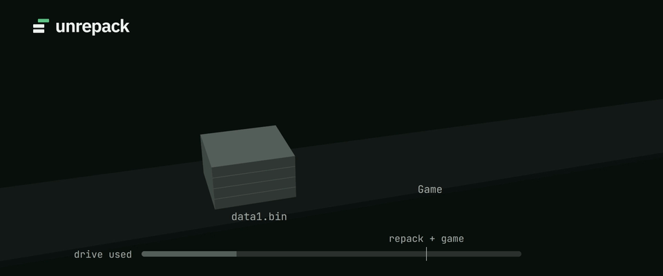

<h1 align="center">unrepack</h1>

<p align="center">
  
</p>

<p align="center">
  Unpack FreeArc game repacks without running their installer.<br>
  The repack can give its space back while it is read, so the repack and the game<br>
  never have to fit on the disk <em>together</em>.
</p>

<h4 align="center">
  <a href="#usage">Usage</a> |
  <a href="#status">Status</a> |
  <a href="#is-unrepack-safe">Safety</a> |
  <a href="#how-it-works">How it works</a> |
  <a href="#build-and-test">Build</a> |
  <a href="#license">License</a>
</h4>

<p align="center">
  <a href="#license"></a>
  
  
</p>

unrepack is a free, open-source app and command line tool for Windows. It extracts the data files of game repacks built on FreeArc, such as DODI and FitGirl repacks, straight into a game folder. It checks every file's CRC as it goes. It does not run the installer, so there is no installer UI, registry editing or redistributable setup.

A repack's installer needs room for the repack **and** the whole game at once. Crusader Kings III [DODI Repack] is 6.05 GB packed and 19.87 GB installed, so it needs about 26 GB of disk. With `--free-as-read`, unrepack needs 13.94 GB. It gives each data file's bytes back to the disk as soon as they are decoded, so the space the repack frees holds the game files that follow.

## Usage

### The app

Run `unrepack-gui.exe` as administrator; the repacks' decoders don't work without it. Pick the repack folder and where to install. If the repack offers languages or extras (movies, artwork, soundtracks), tick the ones you want, as in the installer: English starts ticked and the other languages don't. The decoders are read out of the repack's `Setup.exe`, so their folder can stay empty. Then choose what happens to the repack and press **Check space** or **Unpack**. The app runs `unrepack.exe` next to it and shows its progress and log, so it does exactly what the command line does, with the same checks. It asks before any mode that deletes or frees the repack, and before stopping a run that would lose it.

Keep `unrepack-gui.exe`, `unrepack.exe` and `unrepack-clshost.exe` in the same folder.

### See whether it fits

```bash
unrepack extract "Game [DODI Repack]" -o "D:\Games\Game" --check --free-as-read
```

`--check` reads every data file's index and the disk's free space, and changes nothing.

### Extract

```bash
unrepack extract "Game [DODI Repack]" -o "D:\Games\Game"                  # keep the repack
unrepack extract "Game [DODI Repack]" -o "D:\Games\Game" --delete-each    # delete each data file once it's out
unrepack extract "Game [DODI Repack]" -o "D:\Games\Game" --free-as-read   # free the repack while reading it
unrepack list "Game [DODI Repack]\data1.doi"                                # what's inside
unrepack parts "Game [DODI Repack]"                                         # which data files are languages or extras
unrepack decoders "Game [DODI Repack]\Setup.exe" -o <folder>               # copy the decoders out
```

The input can be a repack folder (every FreeArc data file in it is used) or one or more data files.

### Languages and extras

Repacks put each language and each extra in a data file of its own, and the installer asks which to install. `unrepack parts` sorts a folder's data files by name: DODI's `data<N>` and FitGirl's `fg-<N>` always install, language packs (`English.doi`, `fg-selective-french.bin`) are languages, and anything else is an extra. To choose, name the data files you want:

```bash
unrepack extract "Game [DODI Repack]\data1.doi" "Game [DODI Repack]\data2.doi" "Game [DODI Repack]\English.doi" -o "D:\Games\Game"
```

Language packs often hold the same file, such as `sound\desktop.ini`. As with the installer, the copy from the data file named later is kept, and unrepack says which. The sorting goes by file names alone. The installer's own choices and defaults are in its compiled script, which unrepack doesn't read.

The repack's own decoders are needed too: `cls-*.dll` plug-ins, their `cls-*_x64.exe` / `cls-*_x86.exe` helpers, `cls.ini`, and `arc.ini` with any external decoders it names (FitGirl's `rzw.exe`, for example). unrepack reads them out of the repack's `Setup.exe` (Inno Setup 5.5, as DODI and FitGirl use) into a temporary folder, the way the installer would put them in `{tmp}`, without running anything in it. Every file is checked against the SHA-1 the installer stores, Inno's CALL/JMP filter is undone, and `{app}` / `{tmp}` in the `.ini` files become the decoders' working folder. The folder is removed when the run ends. `--decoders <folder>` uses a folder of decoders instead, and so does a repack folder that already holds them. Antivirus programs often flag a repack's `Setup.exe` (Windows Defender removed FitGirl's as `HackTool:Win32/Crack!MTB` when unrepack opened it); without it, unrepack says so and needs `--decoders`.

| Option | Effect |
|---|---|
| `-o, --output <dir>` | Output folder |
| `--decoders <dir>` | Folder with the repack's decoders, instead of reading them out of `Setup.exe` (see above) |
| `--host <exe>` | The 32-bit CLS host. Default: `unrepack-clshost.exe` next to `unrepack.exe` |
| `--work <dir>` | Where decoders run and keep their temp files. Default: `<output>\.unrepack-work` |
| `--log <file>` | Also write every message, and a progress line every 5 s, to a file |
| `--check` | Plan only: say whether it fits, change nothing |
| `--delete-each` | Delete each data file once all of it is extracted. Crash safe |
| `--free-as-read` | Free each data file's bytes as they are decoded. **Not crash safe** (see [Safety](#is-unrepack-safe)) |
| `--no-verify` | Skip the decode-only pass that checks every CRC before anything is freed or deleted. Halves the time and removes the safety net |
| `-y, --yes` | Don't ask before freeing or deleting |

### Space each mode needs

Measured by `--check` on Crusader Kings III [DODI Repack] (6.05 GB packed, 19.87 GB of game):

| Mode | Needs free | Crash safe |
|---|---|---|
| Default | 19.99 GB | Yes, the repack is kept |
| `--delete-each` | 19.49 GB | Yes, each data file is deleted only once it is fully extracted |
| `--free-as-read` | 13.94 GB | **No.** A crash or a decoder failure after the first freed byte loses the repack |

The `--check` figures come before any decoding. They assume the freed input keeps pace with the output, and they leave out the decoders' temp files. The verify pass measures both and checks the space again before anything is freed.

## Status

Every result below was run on real repacks. "Every CRC matching" means each file's CRC-32 matched the one stored in the FreeArc directory.

| Repack | Data | Result |
|---|---|---|
| Crusader Kings III [DODI Repack], `data1.doi` | 5.74 GB solid block, `cls-lolz` + `cls-srep` | 51,467 files, 19.37 GB, every CRC matching. About 5.5 min for verify plus extract |
| Crusader Kings III [DODI Repack], `data2.doi` | `cls-lolz` + `cls-srep` | 1,177 files, 496 MB, every CRC matching, about 10 s. Also freed as read: the repack copy was used up, and the files were identical to a run that kept it |
| A FitGirl repack, `fg-01` | `xt2png+pref+srep+magic2` | 7,329 files, 2.13 GB, every CRC matching |
| A FitGirl repack, `fg-02` | `mpzz+srep` | 2,992 files, 136.53 MB, every CRC matching |
| A FitGirl repack, `fg-03`, `fg-05` | `srep+dispack070+delta+rzwb`, with built-in `dispack070` and `delta` | 14 and 3 files, 106.77 MB and 303.65 KB, every CRC matching |
| A FitGirl repack, `fg-04` | `magic2` | 1 file, 638.62 KB, CRC matching |
| A FitGirl repack, `fg-selective-videos-sd` | `srep+4x4:rzw` | 3,676 files, 2.65 GB, every CRC matching |

FitGirl's own MD5 lists name 14,011 game files, and 4,210 of them match the output byte for byte. The other 9,800 are RPG Maker MV images and audio that the repack stores unencrypted, and its installer encrypts them afterwards. One file, a title movie, ships inside `Setup.exe` rather than in any data file.

No repack using `tor` or `lzma` has been tried yet. Archives made by FreeArc 0.67's own `Arc.exe` from 137 MB of game files, programs and text extract with every CRC matching. That covers `tor:1` to `tor:11`, `lzma` fast, normal and max, and `4x4` around both, including frames 4x4 stored because they didn't compress. FreeArc's `-m1` to `-m9` presets also use `rep`, `exe`, `grzip` or `ppmd`, so archives made with them are still refused.

| Part | State |
|---|---|
| FreeArc directory, footer and CRCs | Works |
| CLS plug-ins (`cls-*.dll`) through the 32-bit host | Works |
| External decoders from `arc.ini` | Works |
| FreeArc built-ins `delta`, `dispack070` and `tor` (Tornado) | Works, ported natively |
| FreeArc built-in `lzma` | Works, through the `lzma-rust2` crate |
| `4x4` around an external decoder or a built-in above | Works |
| Other FreeArc built-ins (`ppmd`, `rep`, `exe`, `lzma2`, …), and `4x4` around a CLS plug-in | Not yet: refused before anything is changed |
| Resume after a crash | Not in 0.1 |
| Choosing languages and extras | Works, by data file name: `unrepack parts`, and tick boxes in the app |
| Installer steps (registry, redistributables, post-install patches such as FitGirl's RTPatch `.x3` files and `restore-duplicates.bat`) | Not done. Only the files inside the data files are extracted |

## Is unrepack safe

> [!WARNING]
> **unrepack runs the decoders that came with the download.** A repack's `cls-*.dll`, its helper `.exe` files and the programs `arc.ini` names are programs from the download. Use repacks you trust.

- **Nothing is freed until the whole repack decodes.** Before `--free-as-read` or `--delete-each` changes anything, a verify pass decodes every data file and checks every file's CRC. That pass also measures the decoders' temp files and how far the output runs ahead of the input, and checks the free space again with those numbers. `--no-verify` skips it.
- **A full disk pauses the run instead of ending it.**
- **A half-freed data file is never used again.** A marker file, `<data file>.unrepack-consumed`, makes any later run refuse it.
- **The decoders can't hang the run.** A decoder's error dialog is written to the log instead of waiting for a click. Every decoder process goes into one job object: if one stage fails, the whole chain stops.
- **Built-in decoders don't trust the stream.** Where FreeArc's C code trusts sizes read from the data, the ports refuse bad ones.
- **Decoders stay in their folder.** An `arc.ini` entry that names a program outside the decoders folder is refused.

What it can't protect against in 0.1: with `--free-as-read`, a crash, a power cut, or a decoder failure after the first byte is freed loses the repack. That includes a decoder's own temp file hitting a full disk, which the measured check above is the only guard against. Use `--delete-each`, or keep the repack, when it can't be downloaded again.

## How it works

A FreeArc data file is a series of solid blocks, each packed by a chain of methods (for example `srep+dispack070+delta+rzwb`), with a directory at the end that lists every file, its block and its CRC. unrepack reads that directory, then decodes each block by running the chain from right to left as a pipeline of stages:

- **CLS plug-ins** are 32-bit DLLs. Each one runs in `unrepack-clshost.exe`, a small 32-bit host process, and data goes through pipes.
- **External decoders** from `arc.ini` run as processes in the work folder.
- **`4x4`**, **`delta`**, **`dispack070`**, **`tor`** and **`lzma`** run as threads inside unrepack. `delta`, `dispack070` and `tor` are Rust ports of FreeArc 0.67's decoders, and the tables of the first two match the repack's own `unarc.dll` byte for byte. `lzma` is FreeArc's raw LZMA stream, with its settings taken from the method string.

The last stage's output is cut into files, and each file's CRC is checked. With `--free-as-read`, unrepack zeroes the parts of the data file it has read as a sparse range (`FSCTL_SET_ZERO_DATA`), so NTFS gives that space back while the file keeps its size and offsets. Once a data file is fully read, it is deleted.

## Build and test

Windows, with [Rust](https://rustup.rs) and a 32-bit MinGW `gcc` for the CLS host:

```bash
cargo build --release
gcc -m32 -O2 -s -static -o target/release/unrepack-clshost.exe clshost/clshost.c
cargo test --release
```

`cargo build --release` builds both `unrepack.exe` and the app, `unrepack-gui.exe` (egui, a single native exe). The tests write FreeArc archives in the layout measured from real repacks and run the binary on them. They use `storing`, `copy`, and a CLS codec built from `clshost/test_copy.c`, so the host process runs as it does with a repack's decoders. `delta` and `dispack070` are tested on hand-built streams. `tor` and `lzma` are tested on streams made by FreeArc 0.67's own Tornado compressor and by liblzma, and `4x4` around them on streams cut from archives FreeArc 0.67's `Arc.exe` made (see [testdata/README.md](testdata/README.md)). `UNREPACK_SAMPLE=<data file> cargo test real_sample` also parses a real data file, and `UNREPACK_DUMP=<dir>` saves every stage's output for debugging.

## License

unrepack is licensed under either of [Apache License, Version 2.0](LICENSE-APACHE) or [MIT license](LICENSE-MIT), at your option, **except `src/builtin.rs` and `src/tornado.rs`**.

`src/builtin.rs` holds the ports of FreeArc's `delta` and `dispack070` decoders, and `src/tornado.rs` the port of its `tor` decoder. Both stay under the terms of the FreeArc source they come from ([LICENSE-FREEARC](LICENSE-FREEARC)). The `delta` decoder is free to use only for decompressing FreeArc archives, and it is not open source. `dispack070` and `tor` come from FreeArc's GPL-2.0 tree. Without those two files, unrepack is open source throughout, but it can't decode repacks that use those three methods.

Parts of `src/win.rs` are adapted from [HatchZip](https://github.com/xevrion/hatchzip) under its MIT license. That copyright notice is kept in [LICENSE-MIT](LICENSE-MIT).

Unless you explicitly state otherwise, any contribution intentionally submitted for inclusion in unrepack by you, as defined in the Apache-2.0 license, shall be dual licensed as above, without any additional terms or conditions.
